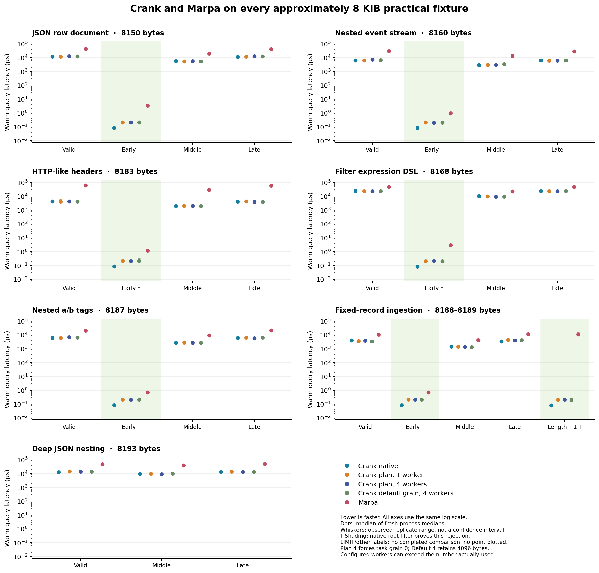

# Superintelligence preamble

The human (me) provided an initial research parser implementation, which was flawed but
sufficiently introduced initial core parsing concepts (the initial focus was arithmetic
criteria for failing parses), and iterative prompting yielded a correct and expanded
implementation. From there, coideation between human and SI iterated a substantially
expanded architecture, featuring a demand driven scheduler and small virtual machine.

I understand the majority of the architectural design. I proposed about half of it. GPT
authored the implementation.

# Crank

Crank is a context free parser with a few context sensitive extensions. Where here
measured, it's generally faster than Marpa (libmarpa with leo), and it can reject
large classes of non-matches faster than pcre2 and hyperscan. This is achieved by
compiling the expression and tracking various arithmetic conditions on parsing nodes,
and by leveraging derivatives recombination with optional speculative multithreaded
lookahead.

Conceptually, Crank builds a graph of partial matches across the expression’s nodes.
Each derivative represents what remains to be matched after consuming part of the input.
Successful child matches advance their enclosing expressions; when those obligations are
satisfied all the way to the root, the expression matches. The scheduler shares equivalent
work and propagates results through this graph as they become available.

Crank’s scheduler organizes parsing as shared, demand-driven work. A request asks whether
an expression can match from a given position, possibly with a required endpoint. Equivalent
requests share one computation, and callers subscribe to its results. New matches resume the
callers that need them, while later callers can reuse results already found. This lets
recursive grammar rules reach a fixed point without repeatedly expanding the same work.

The scheduler also provides the coordination layer for optimizations: arithmetic constraints
can rule out impossible work, while admitted specialized paths answer suitable requests more
directly. Requests outside those paths retain the general parsing machinery.

Eligible expressions use finite-state, scan, count, equality or affine plans for speed.

For matches that depend on captures, repetition counts or occurrence histories, Crank uses an
occurrence VM that tracks this state as parsing proceeds. Two matches covering the same span
may carry different state, so the VM preserves distinctions that a simple endpoint result would
lose. Crank can use shared results or specialized execution where doing so preserves both the
expression’s constraints and the observations requested by the caller.

## Build and try

Use Python 3, a C++20 compiler, and POSIX threads. GCC 11.4 on Ubuntu 22.04/WSL
is the verified compiler for this release. The default build needs no external
matching library.

```sh
make
./build/hybrid/crank '(a|b)*' abab
./build/hybrid/crank '(?<S>a(?&S)b|)' aaabbb
./build/hybrid/crank --explain '(?<S>a(?&S)b|)'
```

```sh
python3 tools/test.py --quick
python3 tools/build.py libcrank
```
## Recorded benchmarks

### Independent grammar frontends — 12 October 2026

The new [Crank / Marpa::R2 Scanless comparison](benchmarks/marpa_scanless/README.md)
measures Boolean whole-input recognition with independently authored grammar
frontends: C++ Crank at publication checkpoint `f57ac0a` versus Perl/C
Marpa::R2 14.000000 (Libmarpa 11.0.2). The initial 32-entry, eight-family suite
gave Crank Auto and Progress4 lower warm wall estimates on 31 of 32 entries;
geometric Marpa/Crank ratios were 98.7x and 26.7x. The malformed 79-byte regex
was a measured loss for both modes. Preparation, first query, reused queries,
child process lifetime, CPU and wall time are reported separately.

The 64-entry control completed all entries after foreground accounting caps
were removed in the benchmark wrapper: Auto won 64 and Progress4 63. Production
limits are unchanged; the configured run's eight `ResourceLimit` outcomes
remain visible. Marpa warning output affected three regex entries in the wide
suite, and a separate targeted diagnostic includes unexplained aborts. These
phases are not pooled into a global score. The common-count confirmation's
127x / 29.9x ratios describe batch-average per-input costs, not singleton tails.
Public results retain losses, nondecisions and coverage; replacement synthetic
fixtures are supplied for new reruns without claiming historical measurements
for changed inputs. The expression-preparation improvement is subsequent to
this campaign; [integration status and remaining research gates](docs/POST_PUBLICATION_AUDIT.md)
are recorded separately.

### Historical practical comparison



This original graph records the **11 September 2026** Constraint Parallel Core:
28 approximately 8 KiB cases across seven practical language families. It compares
full-span byte membership with the pinned **Libmarpa 11.0.13 + Leo byte-token
adapter**. Dots are medians of three fresh-process medians; whiskers show the
observed range. The logarithmic axis shows warm queries with prepared objects
and resident inputs, excluding preparation and first-query costs. The graph's
planner configurations belong to the historical engine; these practical cases
actually used one worker. The October 8 integration has no new performance
measurements. [Original data, scope and figure recreation](benchmarks/historical/marpa-practical/README.md)

### Rejection by arithmetic conditions

The following saved **16 September 2026** measurements are bound to production
engine checkpoint `6851a56ddb8b0bd9bae1d47a6b35a2a24c470222`. They compare anchored,
Boolean full-span byte membership with PCRE2 10.42 JIT and Hyperscan 5.4.2.
Each row completed `NoMatch` in all three first-query and warm-query process
records; unsupported patterns, compilation failures, timeouts and resource
limits are separate outcomes and are excluded from speed comparisons.

| Expression and input | Crank Auto, warm µs | PCRE2 JIT, warm µs | Hyperscan, warm µs | Warm advantage over JIT / Hyperscan |
|---|---:|---:|---:|---:|
| `(?:a{127})*(?:a{131})*`, `a` repeated 16,379 times | 0.100443 | 649.200087 | 1,467.318222 | 6,463× / 14,608× |
| `(?:a{127}){0,63}(?:a{131}){0,63}`, `a` repeated 8,191 times | 0.104835 | 158.572644 | 14.790809 | 1,513× / 141× |

In the first family, a match needs nonnegative integers satisfying
`127x + 131y = 16379`; no solution exists. In the second, the same necessary
length equation at 8,191 has no solution within the repetition bounds. The
compiled certificate can therefore reject every byte string of the specified
length without scanning its contents. The timings above measured the exact
frozen `a`-only fixtures. Certificate preparation and input construction remain
outside the warm-query comparison.

Preparation can reverse a warm result: for the 8,191-byte bounded fixture,
saved cold preparation-plus-first-query latency was **384.800 µs for Crank**
and **270.147 µs for PCRE2 JIT**. Hyperscan also wins selected warm rejections:
the bounded expression at overlength 16,379 took **0.009677 µs** against Crank's
**0.052080 µs**; a 131,064-byte fixed-record input with a bad final digit took
**0.030922 µs** against **0.055185 µs**. These results establish particular
crossovers, rather than a speed guarantee for regular matching or tokenized
Marpa applications. [Exact fixtures, saved results and conditions](benchmarks/historical/rejections/README.md)

### Late rejection through optional assistance

A separate **16 September 2026** campaign measured a 131,040-byte nested event
stream whose final `samples=[` was changed to `samples[=` at byte 131,030. The
length and end boundary remain plausible; the interior `[=` pair is forbidden
by the grammar. Helpers scan later input partitions and publish a completed
negative certificate that the foreground can consume before parsing reaches
that error.

| Same historical executable and input | Warm foreground latency, µs |
|---|---:|
| Native request scheduler | 302,452.066 |
| Progress assistance, 2 total workers | 381.174 |
| Progress assistance, 4 total workers | 202.565 |
| Synchronous scan of the same proof | 215.064 |

The four-worker assisted run was about **1,493× faster than native**. All three
saved diagnostic replicas consumed a root rejection proof after admission at
512 native steps, and each five-query warm phase recorded five helper root
publications. Native also completed `NoMatch`; this comparison does not count
resource exhaustion as rejection. Worker counts include the caller. The measured
source was `0f21957bcbb77e7ad2ff4a2b7cf71b64bedb37e5`, retained as
`c3089443fd1594691bdc904a2ef212c1cbb80ad3`.

The synchronous control shows that avoiding native parsing with a sound
certificate provides most of this gain. Four-worker assistance was only about
1.06× faster than that scan and used more total CPU. Preparation, first-query
costs and helper draining are recorded separately. Cheap rejections can lose
time to helper overhead, and the October source has no new performance campaign.
[Exact event and late-marker fixtures, causal counters and historical conditions](benchmarks/historical/assistance/README.md)

### Reproduce

The [benchmarks folder](benchmarks/README.md) contains historical measurements,
figure recreation, and a portable runner for the current source. It separates
correctness checks, preparation, first query and reused warm queries, and
records nondecisions explicitly. Its instructions give the pinned dependencies,
input generators, commands for new result files and charts, and a bounded smoke
check. Historical plots can be recreated without running a performance campaign;
new runs report their own source and dependency versions.
